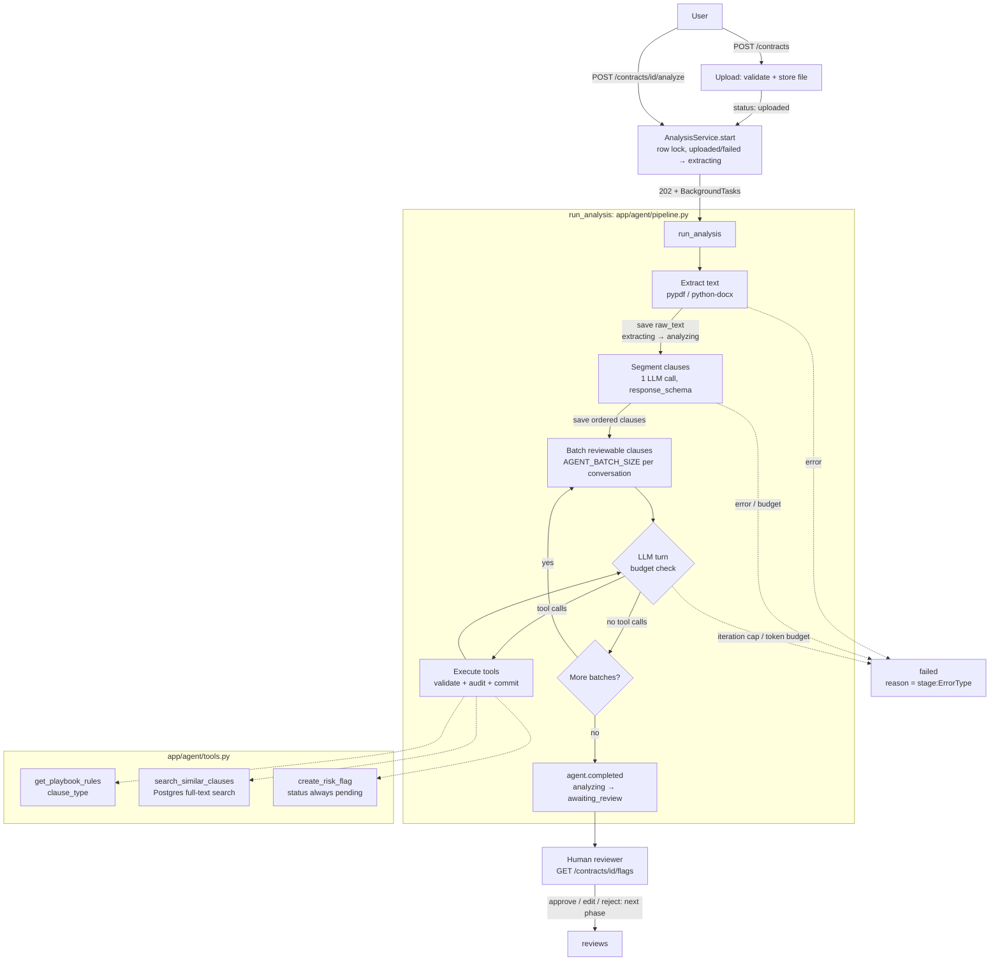
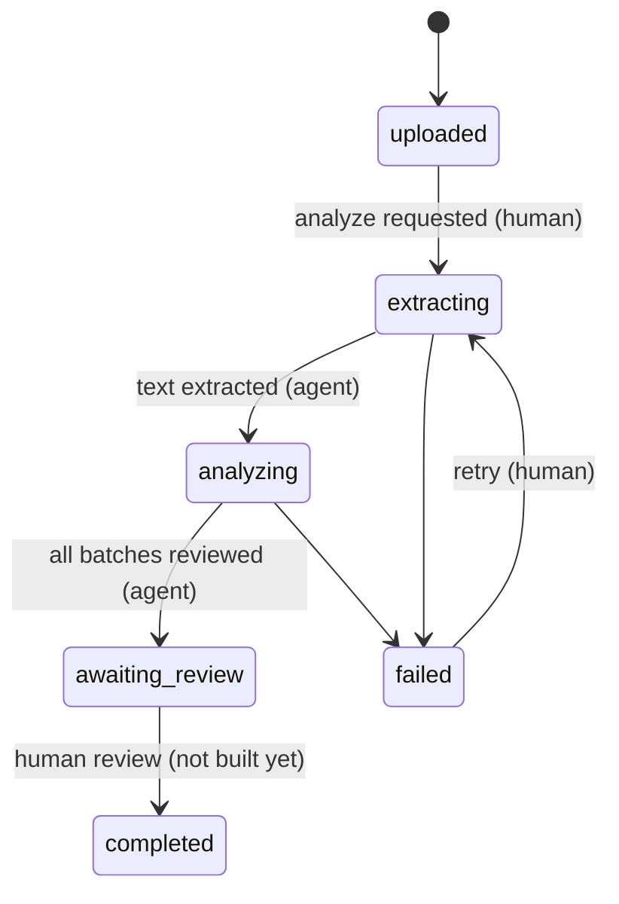

# Architecture

How a contract moves through the system, from upload to human review. Code paths are relative to `backend/`.

## Components

| Component | Code | Role |
|---|---|---|
| API | `app/api/contracts.py` | Thin FastAPI routes: upload, start analysis, read contract and flags |
| Services | `app/services/` | Upload and storage, text extraction (`text_extraction.py`), starting analyses (`analysis_service.py`) |
| Agent | `app/agent/` | The analysis pipeline: segmentation, the tool-calling review loop, budgets |
| Playbook | `playbooks/default.yaml`, `app/playbook/` | Policy rules as data, validated on load |
| LLM layer | `app/llm/` | `get_llm_provider()`: provider adapter + retries + `llm.call.*` audit events |
| Prompts | `app/prompts/<name>/v<N>.md` | Versioned prompts, recorded by name, version and sha256 on every call |
| Repositories | `app/repositories/` | DB access, including the status machine and the append-only audit log |

## Agent flow

## Contract status machine

Transitions are defined in one place, `ALLOWED_TRANSITIONS` in `app/repositories/contract_repository.py`. `ContractRepository.transition()` rejects anything else and writes a `contract.status_changed` event in the same transaction. The agent can never move a contract past `awaiting_review`.

## Guards

All limits apply per contract and come from settings:

| Setting | Default | Effect |
|---|---|---|
| `AGENT_MAX_CONTRACT_CHARS` | 60,000 | Longer extracted text fails at `extracting` before any LLM call |
| `AGENT_BATCH_SIZE` | 5 | Clauses per review conversation; keeps each request small |
| `AGENT_MAX_ITERATIONS` | 25 | Total LLM calls (segmentation + every tool-loop turn) |
| `AGENT_TOKEN_BUDGET` | 150,000 | Total tokens across all calls; checked before each call |

When the iteration or token limit is hit, the agent writes `agent.stopped` and the contract goes to `failed`. A partial review shouldn't look complete to a reviewer. Flags created before the stop stay `pending` for inspection, and a retry replaces the clauses and flags.

Clauses segmented as `other` (no playbook rule applies) are not sent for review, which saves calls; this is recorded as `agent.clauses_skipped`.

## Tools

| Tool | Does | Validation |
|---|---|---|
| `get_playbook_rules(clause_type)` | Returns the rules for a clause type: description, risk criteria, default severity | Non-empty string; unknown types return no rules |
| `search_similar_clauses(text, limit?)` | Postgres full-text search (generated `clauses.search_vector`, GIN index) over **other** contracts' clauses, with their flags and review status | Text reduced to sanitized keywords OR-ed into `to_tsquery`; limit clamped to 1–5 |
| `create_risk_flag(clause_id, rule_id, severity, score, rationale)` | Creates a `pending` risk flag | Clause must be in the current batch; rule must exist; severity enum; score 0–1; one flag per (clause, rule), also enforced by a unique constraint |

Invalid calls aren't raised. They go back to the model as `{"ok": false, "error": ...}` so it can correct itself, and they are audited with an `error_code`. The tool schema has no status argument: every flag starts `pending` and only a human can change it.

## Audit events

Every step appends to `audit_events` (append-only, enforced by a database trigger). Payloads hold metadata only: no contract text, prompts, rationales or API keys.

| Event | Actor | Payload |
|---|---|---|
| `contract.uploaded` | human | filename, content type, size, sha256 |
| `contract.status_changed` | human / agent | `from`, `to`, `reason` (failures: `stage:ErrorType`) |
| `contract.text_extracted` | agent | `chars` |
| `llm.call.succeeded` / `llm.call.failed` | agent | provider, model, prompt name/version/sha256, latency, attempts, tokens, tool names |
| `agent.clauses_segmented` | agent | clause count, counts by type, prompt version |
| `agent.clauses_skipped` | agent | count, reason |
| `agent.batch_started` / `agent.batch_completed` | agent | batch number, clause ids, turns, flags created |
| `agent.tool_call` | agent | tool, ok, error_code, clause/rule ids, result count, query length |
| `agent.flag_created` | agent | flag id, clause id, rule id, severity, score, status, playbook version |
| `agent.stopped` | agent | `max_iterations` or `token_budget`, stage, calls and tokens used |
| `agent.completed` | agent | clauses, batches, flags, LLM calls, total tokens, playbook version |

## Transactions

- Each pipeline stage commits its own work, and every tool call commits on its own, so the audit trail survives a later failure.
- LLM audit events are written in their own session (see `AuditedLLMProvider`), so failed calls are recorded even when the pipeline rolls back.
- On failure the pipeline rolls back, then moves the contract to `failed` in a fresh transaction.

## Running in Lambda (later)

`run_analysis` is a plain function. FastAPI's `BackgroundTasks` runs it in-process today. On Lambda, the analyze route will instead invoke it asynchronously (for example, a second Lambda invoked with `InvocationType=Event`), because a Lambda freezes once the response is sent.
